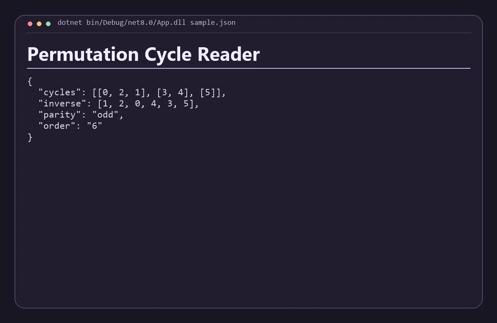

# Permutation Cycle Reader

Decompose a finite permutation, compute its inverse, and find how many repetitions return it to the identity.



## Run

Install .NET 8 SDK and runtime. Run these commands from the repository root.

```sh
dotnet build --nologo
dotnet bin/Debug/net8.0/App.dll sample.json
```

Replace `sample.json` with a JSON file following the same structure. The app prints a JSON report to standard output.

Provide a zero-indexed array. The value at index i is where i maps. Order is output as a decimal string because it can exceed a standard integer.

## Verify

Run `python check.py` with Python 3.11 or newer after the build step when applicable. The check verifies the bundled scenario and confirms that an invalid input returns an error.
